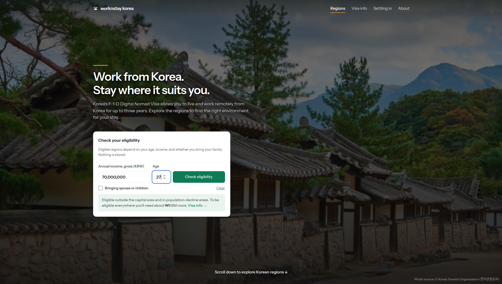
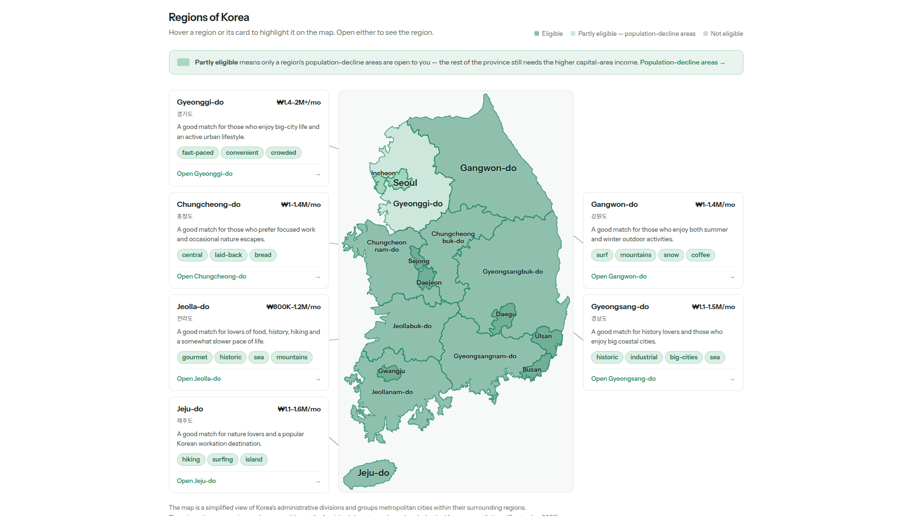

# Work&Stay Korea

Korea's Digital Nomad Visa (F-1-D) has an income threshold that depends on the applicant's age
and the region a person would like to settle in. Work&Stay Korea is an English-language
site built to visualize those rules and make it easier to choose the most suitable area to live.

The site takes income, age, and family-accompaniment status as input and highlights which of
Korea's six regions the applicant is eligible for. Each region page then surfaces workation-
friendly co-working spaces, curated local food, and live data from two public APIs: nearby
attractions and festivals from the Korea Tourism Organization (KTO), and study-café density from
Kakao® Local.

**Live site: <https://worknstay-korea.com/>**




Built solo for the 2026 [관광데이터 활용 공모전](https://api.visitkorea.or.kr/#/cntSearchDetail?no=3)
(Tourism Data Utilization Contest), ②-2 웹·앱 구현 부문, Designated Task #4 — sustainable
long-term residency vs. one-off tourism in population-declining regions.

## What it does

- **Eligibility calculator** — walks through the actual F-1-D income rules (which differ by age,
  region, and family status) and greys out regions the user doesn't qualify for on an interactive
  map. Gyeonggi-do's officially designated population-decline counties are counted as qualifying
  for the lower, non-capital threshold, so the region shows as partly eligible.
- **Region pages** — workation cities with rental prices, co-working spaces, study cafés, and
  getting-around info for each of Korea's six regions.
- **Live attractions & festivals** — fetched from the KTO English Tourism Information OpenAPI on
  every page view, not from a cached snapshot (see [Why the API calls are live](#why-the-api-calls-are-live)).
- **Local food guide** — hand-picked regional dishes with photo credits and sourcing.
- **Visa info, Settling in and About pages** — the F-1-D eligibility rules, documents and FAQ; a
  general guide to renting, workspaces and communities in Korea; and a note on who makes the
  site and why.
- **Works without JavaScript, up to a point** — every region link is a real anchor, and static
  content renders as is. The calculator, live map highlighting and the API-fed blocks
  (attractions, festivals with their Ongoing/Upcoming tabs, study-café counts) need JS and show a
  `<noscript>` message or empty state instead.

## Tech stack

Kept deliberately simple and stable — no build chain or dependency churn to babysit while
maintaining this solo:

- **[Eleventy (11ty) v3](https://www.11ty.dev/)** + Nunjucks templates — static site generation,
  the only runtime dependency
- **Hand-written CSS** — custom properties, Grid/Flexbox, no Tailwind or build step
- **Vanilla ES modules** — no client-side framework
- **Inline SVG** for the region map — no Leaflet/Mapbox, no map-tile API key
- **[Cloudflare Pages + Pages Functions](https://pages.cloudflare.com/)** — static hosting, plus
  a thin serverless proxy for the live KTO and Kakao® Local calls
- **[Wrangler](https://developers.cloudflare.com/workers/wrangler/)** — the one dev dependency;
  runs Pages Functions locally and deploys

Versions are pinned (`package-lock.json`, `.nvmrc`, `engines`), with no automated dependency bumps.
See [`ARCHITECTURE.md`](./ARCHITECTURE.md) for the full breakdown of the stack, data models, and
known quirks of the KTO API.

## Why the API calls are live

- **KTO (attractions, festivals):** the contest requires *checkable* use of the OpenAPI — judges
  inspect the call history on the submitted key — so a build-time scrape committed as JSON
  wouldn't count. These calls are made server-side on every region-page visit, with nothing cached.
  This is a contest-driven choice; KTO's terms should be re-checked before changing it after the
  contest.
- **Kakao® (study cafés):** Kakao®'s terms don't allow caching or storing Local API results in any
  form, so counts are fetched in real time and responses are `no-store`. Sources:
  [Kakao® Maps API docs](https://developers.kakao.com/docs/en/kakaomap/common) and the
  [Kakao® DevTalk thread](https://devtalk.kakao.com/t/local-api/151745/5) on permitted use.

In both cases the key lives only in the Cloudflare environment (or your local `.env`) and never
reaches the client or the repository. Everything else is static: editorial data, plus hero and
dish photos hand-picked once (KTO APIs, Wikimedia Commons, own photos) and committed with their
credits, since which photo represents a region or dish is an editorial choice.

## Study-café battery

Each city card shows a 4-cell battery for study-café density.

- **Live:** a Pages Function searches `<city> 스터디카페` via the Kakao® Local keyword search,
  keeps results whose category/name match and whose address is in that city (the search spills
  into neighbouring cities), and maps the count to a level. Kakao® caps any query at 45
  retrievable results; past that, the count is estimated by scaling Kakao®'s `total_count` by the
  share of retrieved results that passed the filter. Cards show "loading…" while calls are in
  flight; network and 5xx errors are retried once, quota (429) and other 4xx errors are not.
- **Thresholds** (`src/_data/studyCafeLevels.json`): 0 → none (0 cells), 1–9 → a few (1),
  10–29 → good (2), 30–99 → lots (3), 100+ → plenty (4).
- **Fallback:** each city carries an editorial `fallbackLevel` in `src/_data/cities.json`,
  estimated by hand on Naver Map. It is all-or-nothing per region page: if any city's live call
  fails (or no Kakao® key is set), every card on that page shows its fallback level plus a note
  that the data is a manual editorial estimate.

## Getting started

To run a local copy for review or development:

Requires Node 24.19.0 (see `.nvmrc`).

```bash
npm install
cp .env.example .env          # then fill in KTO_API_KEY and KAKAO_REST_API_KEY
npm run pages:dev             # http://localhost:8788
```

`pages:dev` runs the full stack — Eleventy build + Cloudflare Pages Functions — so the live
endpoints work locally. It doesn't watch files; rerun `npm run build` after an edit. Plain
`npm run serve` only serves static Eleventy output: the `/api/**` routes won't exist and the
attraction/festival sections render their empty state.

Both `wrangler pages dev` and the scripts under `scripts/` read keys from the single gitignored
`.env`.

**No keys yet, just want to work on the UI?** Both keys are optional locally.
- Without `KTO_API_KEY`, the attractions and festivals Functions skip the live call and serve the
  committed fallback files — real cards to test filters against, zero API calls spent.
- Without `KAKAO_REST_API_KEY`, study-café cards show their editorial fallback levels.

**Testing against real data without burning quota on every reload?** Keep the KTO key set and add
`KTO_DEV_CACHE=1` to `.env`. Repeat requests are served from an in-memory cache instead of
re-hitting KTO.

`KTO_DEV_FORCE_QUOTA=1` makes every KTO call report quota-exceeded, to test the degraded UI.

Both flags are dev-only — never set them in production.

**Scripts:** `scripts/verify-*.mjs` are plain Node checks (no test framework), run with
`node --env-file=.env scripts/<name>.mjs`; the ones that call KTO need the key and spend quota.

## Deploying

Hosted on Cloudflare Pages: build command `npm run build`, output directory `_site`. Set
`KTO_API_KEY` and `KAKAO_REST_API_KEY` as Pages environment variables — they are per environment,
so Production and Preview each need their own. Don't set the `KTO_DEV_*` flags there.
`npm run pages:deploy` deploys from the command line via Wrangler.

## Project layout

```
functions/api/          Cloudflare Pages Functions — live KTO and Kakao® proxies (server-side only)
src/_data/              Editorial content: visa rules, region/city metadata, rental data, fallbacks
src/_includes/          Nunjucks layouts and partials
src/assets/             CSS, JS, SVG, images
src/regions/            Per-region pages (paginated from _data/regions.json)
eleventy/               Eleventy template filters
scripts/                Standalone verification scripts (no test framework)
notes/                  Research notes and raw reference data (not part of the build)
```

## Project docs

- [`ARCHITECTURE.md`](./ARCHITECTURE.md) — stack, folder structure, data models, and KTO
  integration conventions, with the reasoning behind the notable decisions
- [`DESIGN.md`](./DESIGN.md) — visual/design conventions (palette, type, spacing, components)
- [`ROADMAP_TODO.md`](./ROADMAP_TODO.md) — phase-by-phase feature checklist
- [`CLAUDE.md`](./CLAUDE.md) — the operating rulebook for Claude Code in this repo (contest
  constraints, workflow rules, tech-stack conventions)
- [`notes/attraction-gallery-report.md`](./notes/attraction-gallery-report.md) — investigation of the
  optimal KTO calls per region
- [`src/assets/img/brand/README.md`](./src/assets/img/brand/README.md) — brand icon files and usage
- [`docs/contest-functional-spec.pdf`](./docs/contest-functional-spec.pdf) — the functional
  specification submitted to the contest, in Korean

## License / credits

Source is public for review; all rights reserved. Contributions and forks are welcome by
arrangement — open an issue and we'll sort out the license you need.

Solo submission for the 2026 관광데이터 활용 공모전, built with [Claude Code](https://claude.com/claude-code)
as a development assistant.

Data and assets are drawn from several sources, each credited in place on the site:
- **Korea Tourism Organization** (© 한국관광공사) — attractions, festivals, and most hero/dish
  photos, via its OpenAPIs, per its terms.
- **Kakao®** — study-café counts, via the Kakao® Local API.
- **KOSIS** (Korean Statistical Information Service) — city population figures.
- **Wikimedia Commons** — the base province-boundary map, and a handful of dish photos.
